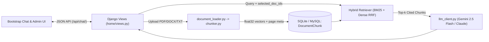

# ChatGoD — Vietnamese Hybrid RAG Chatbot (Django)

A clean, modular **Retrieval-Augmented Generation (RAG)** web application built with **Django 5**, supporting **PDF / DOCX / TXT** ingestion, **Hybrid Search (BM25 + Multilingual Dense Embeddings via Reciprocal Rank Fusion)**, **Google GenAI (`gemini-2.5-flash`)** or **Anthropic Claude**, source citations, and conversation memory.

## Architecture



## Key Improvements Made
- **Security**: Moved all API keys, `SECRET_KEY`, `DEBUG`, and DB credentials out of source code into `.env` (`.env.example` included).
- **Fixed Core RAG Pipeline**: Eliminated `NameError` (`history`), broken `if context and chunks:` guard, fake random embeddings, `split_text_into_chunks()` infinite loop, and `-1` FAISS padding bugs.
- **Multi-Format Ingestion**: Added `.docx` (`python-docx`) and `.txt`/`.md` support alongside `.pdf` (`pypdf`) with page-level citation metadata.
- **Hybrid Retrieval**: Combined `BM25Okapi` lexical matching with multilingual `SentenceTransformer` cosine similarity via **Reciprocal Rank Fusion (RRF)** and wired up per-document filtering (`/selected/`).
- **Clean JSON Chat API**: Replaced full-HTML `DOMParser` scraping with `POST /api/chat/` and `POST /api/chat/clear/`, showing expandable source citations and optional Web Search fallback.

## Quick Start

```powershell
# 1. Create virtual environment and install dependencies
python -m venv .venv
.\.venv\Scripts\python.exe -m pip install -r requirements.txt

# 2. Configure environment variables
copy .env.example .env
# Edit .env and add GEMINI_API_KEY (or ANTHROPIC_API_KEY)

# 3. Apply database migrations & create admin user
.\.venv\Scripts\python.exe manage.py migrate
.\.venv\Scripts\python.exe manage.py createsuperuser

# 4. (Optional) Bulk-ingest sample documents from pdfs/
.\.venv\Scripts\python.exe manage.py ingest_pdfs

# 5. Run automated tests
.\.venv\Scripts\python.exe manage.py test -v 2

# 6. Start development server
.\.venv\Scripts\python.exe manage.py runserver 8000
```
